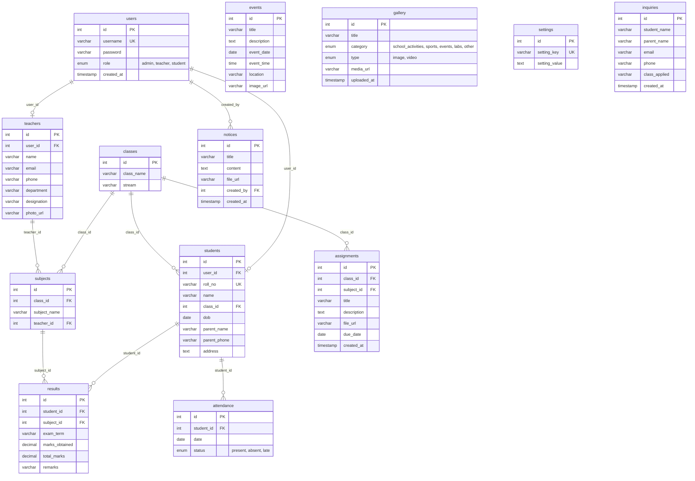

# 🎓 Everest International School Management System & Portal

A modern, responsive, full-stack PHP & MySQL web application and institutional management portal designed for schools, colleges, and educational academies. Built with vanilla PHP (PDO), MySQL, modern CSS3 (Glassmorphism, custom themes, dark/light mode), and vanilla JavaScript.

---

## 📑 Table of Contents

- [Overview & Architecture](#-overview--architecture)
- [Key Features](#-key-features)
- [Complete File & Directory Reference](#-complete-file--directory-reference)
  - [Public Web Pages](#1-public-web-pages)
  - [Student Portal Pages](#2-student-portal-pages)
  - [Authentication & Testing Scripts](#3-authentication--testing-scripts)
  - [Administrative Dashboard (`/admin`)](#4-administrative-dashboard-admin)
  - [API Endpoints (`/api`)](#5-api-endpoints-api)
  - [Configuration (`/config`)](#6-configuration-config)
  - [Styling & UI Assets (`/css`)](#7-styling--ui-assets-css)
  - [JavaScript Scripts (`/js`)](#8-javascript-scripts-js)
  - [Layout Partials (`/includes`)](#9-layout-partials-includes)
  - [Media Assets (`/images`)](#10-media-assets-images)
  - [Multi-Language Backend Examples (`/backend_examples`)](#11-multi-language-backend-examples-backend_examples)
  - [Assistant Configs (`/.qoder`)](#12-assistant-configs-qoder)
- [Database Schema & Seed Data (`school_db.sql`)](#-database-schema--seed-data-school_dbsql)
- [Default Login Credentials](#-default-login-credentials)
- [Installation & Setup Guide](#-installation--setup-guide)
- [Google Analytics Integration](#-google-analytics-integration)
- [Security & Best Practices](#-security--best-practices)

---

## 🏛 Overview & Architecture

The application is structured into four core layers:
1. **Public Web Portal**: Modern responsive website for prospective students, parents, and visitors with academic information, notices, gallery, admissions, and inquiries.
2. **Student Portal**: Secure area where logged-in students access their academic results, attendance tracking, pending assignments, and weekly class timetable.
3. **Admin Management System**: Complete back-office control panel for managing students, faculty, assignments, attendance records, exam results, notices, image galleries, and institution settings.
4. **API & Multi-Language Backends**: RESTful inquiry processing and reference implementations in Go, Java, Node.js, PHP, Python, and Ruby.

```
school_website/
├── 📄 index.php                   # Homepage & dynamic showcase
├── 📄 about.php                   # School history, vision & leadership
├── 📄 academics.php               # Curricula, streams & grading system
├── 📄 admission.php               # Admissions criteria & application form
├── 📄 contact.php                 # Campus location, map & inquiry form
├── 📄 gallery.php                 # Categorized photo/video showcase
├── 📄 notices.php                 # Institutional circulars & announcements
├── 📄 login.php                   # Unified login (Admin, Teacher, Student)
├── 📄 register.php                # Student self-enrollment registration
├── 📄 forgot_password.php         # Account password recovery workflow
├── 📄 logout_portal.php           # Student portal session termination
├── 📄 portal_dashboard.php        # Student personal dashboard & overview
├── 📄 portal_assignments.php      # Student coursework & homework download
├── 📄 portal_results.php          # Student exam report cards & grades
├── 📄 portal_timetable.php        # Student weekly class schedule routine
├── 📄 school_db.sql               # Database schema & initial seed data
├── 📄 test_login.php              # Auth & password verification diagnostic
├── 📄 test_login2.php             # Role-based credential verification diagnostic
├── 📄 README-analytics.md         # Google Analytics setup documentation
├── 📁 admin/                      # Complete administrative dashboard
│   ├── index.php                  # Admin dashboard metrics & counters
│   ├── login.php                  # Dedicated admin login screen
│   ├── logout.php                 # Admin session termination
│   ├── students_manage.php        # Student profiles CRUD
│   ├── teachers_manage.php        # Faculty directory CRUD
│   ├── assignments_manage.php     # Coursework publication & assignment
│   ├── attendance_manage.php      # Daily attendance marker
│   ├── results_manage.php         # Exam grades & marksheet publisher
│   ├── notices_manage.php         # Circulars & bulletin publisher
│   ├── gallery_manage.php         # Multimedia upload & manager
│   ├── settings.php               # School metadata configuration
│   └── includes/                  # Admin header, sidebar & layout
├── 📁 api/                        # RESTful endpoints
│   └── submit_inquiry.php         # Admission inquiry intake handler
├── 📁 config/                     # Core system configurations
│   ├── db.php                     # PDO MySQL connection handler
│   └── analytics.php              # Google Analytics configuration
├── 📁 includes/                   # Public page layout partials
│   ├── header.php                 # Global navigation & theme switcher
│   └── footer.php                 # Global footer & social links
├── 📁 css/                        # Custom styling
│   └── style.css                  # Design system, themes & animations
├── 📁 js/                         # Frontend scripts
│   └── main.js                    # Sliders, modals & dynamic behaviors
├── 📁 images/                     # Media directories
│   ├── gallery/                   # School activity photography
│   └── uploads/                   # Assignment files & user documents
├── 📁 backend_examples/           # Multi-language API alternatives
│   ├── go/                        # Go API server example
│   ├── java/                      # Java Spring AuthController example
│   ├── nodejs/                    # Express.js API server example
│   ├── php/                       # Standalone PHP API example
│   ├── python/                    # Flask/FastAPI backend example
│   └── ruby/                      # Sinatra/Ruby backend example
└── 📁 .qoder/                     # AI assistant workspace configurations
```

---

## ✨ Key Features

- **Responsive Design & Modern Aesthetics**: Glassmorphism cards, CSS custom variables, seamless Dark/Light theme switching with zero flash on reload (`localStorage`).
- **Role-Based Access Control (RBAC)**: Secure multi-tier authentication for Administrators, Teachers, and Students using bcrypt password hashing (`password_hash` / `password_verify`).
- **Student Self-Service Portal**:
  - Real-time attendance percentage metrics.
  - Interactive examination reports, grades (A+, A, B+, B, C+, C, D), and teacher remarks.
  - Coursework tracking with live due dates and download links.
  - Interactive class routine timetable.
- **Full Administration Suite**:
  - Student and Faculty directory management.
  - Daily attendance tracking (Present, Absent, Late).
  - Exam mark recording and automated report card generation.
  - Notice board publishing with date-driven sorting.
  - Media gallery asset management.
- **Inquiry & Admission Pipeline**: Direct inquiry submission into MySQL database with immediate flash feedback.
- **Analytics Ready**: Google Analytics 4 (GA4) integrated with event tracking for button clicks and form submissions.

---

## 🔍 Complete File & Directory Reference

### 1. Public Web Pages

| File | Description | Key Features |
| :--- | :--- | :--- |
| **`index.php`** | Institutional landing page | Hero image carousel slider, dynamic real-time student/teacher counters from MySQL, latest 3 announcements, featured events, and quick action cards. |
| **`about.php`** | About the institution | Mission, vision, core educational values, history timeline, leadership message from the Principal, and campus infrastructure highlights. |
| **`academics.php`** | Academic programs | Class levels (Primary, Secondary, Higher Secondary), academic streams (Science, Management, Humanities, Computer Science), grading criteria, and academic calendar. |
| **`admission.php`** | Admissions portal | Admission procedure steps, eligibility criteria, required documents, fee structures, and interactive inquiry form connected to `/api/submit_inquiry.php`. |
| **`contact.php`** | Contact & campus visit | Physical campus address, phone numbers, contact emails, interactive embedded map, office hours, and visitor message form. |
| **`gallery.php`** | Multimedia gallery | Categorized photo/video portfolio (School Activities, Sports, Events, Labs) with client-side category filters and lightbox view. |
| **`notices.php`** | Bulletin board | Real-time school circulars, academic notices, holiday announcements, and examination dates pulled directly from the database. |

---

### 2. Student Portal Pages

| File | Description | Key Features |
| :--- | :--- | :--- |
| **`portal_dashboard.php`** | Student home dashboard | Displays student name, roll number, assigned class, live calculated attendance percentage, pending assignment count, and recent grade cards. |
| **`portal_assignments.php`** | Coursework tracker | Lists all active homework assignments for the student's enrolled class, subject details, descriptions, submission deadlines, and file attachment links. |
| **`portal_results.php`** | Examination grades | Filter results by academic term (First Term, Mid Term, Final Term), displays marks obtained vs total marks, percentage, calculated letter grade (A+ to D), and teacher remarks. |
| **`portal_timetable.php`** | Weekly routine schedule | Interactive schedule displaying class periods, start/end times, subject names, assigned faculty, and room numbers from Monday through Friday. |
| **`logout_portal.php`** | Secure sign-out | Clears all student session variables (`$_SESSION`), destroys the session cookie, and safely redirects back to `login.php`. |

---

### 3. Authentication & Testing Scripts

| File | Description | Key Features |
| :--- | :--- | :--- |
| **`login.php`** | Unified authentication | Role selector (`student`, `teacher`, `admin`), username/password verification using PDO prepared statements and `password_verify()`. Automatically routes admins to `/admin/index.php` and students to `/portal_dashboard.php`. |
| **`register.php`** | Student registration | New student sign-up form with input validation, class selection, personal info collection, password confirmation, and automatic user creation. |
| **`forgot_password.php`** | Password recovery | Step-by-step account recovery interface for resetting forgotten credentials. |
| **`test_login.php`** | Diagnostic script | Fast verification utility testing database connectivity, admin user retrieval, and raw `password_verify('admin123', ...)` execution. |
| **`test_login2.php`** | Diagnostic script | Prepared statement diagnostic testing multi-parameter authentication queries (`username = ? AND role = ?`). |

---

### 4. Administrative Dashboard (`/admin`)

| File | Description | Key Features |
| :--- | :--- | :--- |
| **`admin/index.php`** | Admin dashboard | High-level metrics: total students, teachers, classes, pending inquiries, attendance summaries, and recent activity audit log. |
| **`admin/login.php`** | Administrator login | Dedicated login gateway with administrative role validation. |
| **`admin/logout.php`** | Admin logout | Invalidates administrative session tokens and redirects to the login screen. |
| **`admin/students_manage.php`** | Student management | Full CRUD interface to register students, assign roll numbers, map classes, view parent details, and update student profiles. |
| **`admin/teachers_manage.php`** | Faculty management | Create and maintain teacher profiles, department affiliations, designations, contact numbers, and subject assignments. |
| **`admin/assignments_manage.php`** | Homework publisher | Create new homework tasks, set target class, select subject, set due dates, and upload reference materials. |
| **`admin/attendance_manage.php`** | Attendance tracker | Mark daily attendance per class and student (`present`, `absent`, `late`), with date pickers and historical attendance queries. |
| **`admin/results_manage.php`** | Report card manager | Input student marks by term and subject, calculate percentages, assign remarks, and publish term results. |
| **`admin/notices_manage.php`** | Notice publisher | Draft, edit, publish, and delete institutional circulars with optional document links. |
| **`admin/gallery_manage.php`** | Media asset manager | Upload photo and video URLs, assign display categories, and maintain the public gallery. |
| **`admin/settings.php`** | Institution configuration | Configure school name, contact phone, official email, campus address, and academic session years. |
| **`admin/includes/`** | Layout components | Header navbar, sidebar navigation menu with active page highlighting, and footer partials. |

---

### 5. API Endpoints (`/api`)

| File | Endpoint | Method | Description |
| :--- | :--- | :--- | :--- |
| **`api/submit_inquiry.php`** | `/api/submit_inquiry.php` | `POST` | Validates submitted inquiries (student name, parent name, email, phone, applied grade), inserts record into the `inquiries` table, and redirects with status flags. |

---

### 6. Configuration (`/config`)

| File | Purpose | Notes |
| :--- | :--- | :--- |
| **`config/db.php`** | Database Connection | Initializes a secure `PDO` connection to MySQL with `ERRMODE_EXCEPTION`, `utf8mb4` charset, and disabled prepared statement emulation. |
| **`config/analytics.php`** | Analytics Settings | Defines `GOOGLE_ANALYTICS_ID`, e-commerce tracking toggles, and debugging constants. |

---

### 7. Styling & UI Assets (`/css`)

| File | Purpose | Highlights |
| :--- | :--- | :--- |
| **`css/style.css`** | Global Design System | 100% custom Vanilla CSS featuring CSS custom properties (`--bg-primary`, `--accent`, `--glass-bg`), light and dark mode color palettes, custom scrollbars, glassmorphic cards, Flexbox/Grid layouts, and micro-interactions. |

---

### 8. JavaScript Scripts (`/js`)

| File | Purpose | Highlights |
| :--- | :--- | :--- |
| **`js/main.js`** | Client Logic | Implements the responsive mobile hamburger drawer, dark/light theme switcher with `localStorage` persistence, hero slider automated carousel, filterable gallery tabs, and modal lightboxes. |

---

### 9. Layout Partials (`/includes`)

| File | Purpose | Highlights |
| :--- | :--- | :--- |
| **`includes/header.php`** | Global Header | Institutional brand logo, responsive navigation links, theme toggle button, Google Analytics tag loader, and font imports (`Inter` & `Outfit`). |
| **`includes/footer.php`** | Global Footer | School address, contact details, quick navigation links, newsletter subscription mockup, social icons, and copyright notice. |

---

### 10. Media Assets (`/images`)

| Directory | Purpose |
| :--- | :--- |
| **`images/gallery/`** | Dedicated storage directory for local school event and campus photographs. |
| **`images/uploads/`** | Storage directory for user avatars, student documents, and assignment attachments. |

---

### 11. Multi-Language Backend Examples (`/backend_examples`)

Demonstration servers showcasing how alternative backend languages can authenticate users and interface with the school database:

| Folder | Technology | Main File | Purpose |
| :--- | :--- | :--- | :--- |
| **`backend_examples/go/`** | Go (Golang) | `main.go` | Lightweight Go HTTP server with JSON authentication handler. |
| **`backend_examples/java/`** | Java | `AuthController.java` | Spring Boot REST controller handling user login and session tokens. |
| **`backend_examples/nodejs/`** | Node.js | `server.js` | Express.js API server demonstrating JWT/session login endpoints. |
| **`backend_examples/php/`** | Standalone PHP | `api.php` | Pure JSON API alternative for head-less architecture. |
| **`backend_examples/python/`** | Python | `main.py` | Flask/FastAPI server with database user verification. |
| **`backend_examples/ruby/`** | Ruby | `app.rb` | Sinatra lightweight authentication server. |

---

### 12. Assistant Configs (`/.qoder`)

| Folder | Purpose |
| :--- | :--- |
| **`.qoder/`** | Configuration folder for Qoder / IDE coding assistant settings, subagents, and custom development skills. |

---

## 🗄 Database Schema & Seed Data (`school_db.sql`)

The database `school_db` contains 13 relational tables organized with foreign keys:



---

## 🔑 Default Login Credentials

All seeded accounts use password `admin123`:

| Role | Username | Password | Target Redirection |
| :--- | :--- | :--- | :--- |
| **Administrator** | `admin` | `admin123` | `/admin/index.php` |
| **Teacher / Faculty** | `teacher1` | `admin123` | Portal / Dashboard |
| **Student** | `student1` | `admin123` | `/portal_dashboard.php` |

> [!TIP]
> Passwords in the database are hashed with PHP's standard `PASSWORD_BCRYPT`. When creating new users manually, use `password_hash('your_password', PASSWORD_BCRYPT)`.

---

## 🚀 Installation & Setup Guide

### 1. Prerequisites
- **Web Server**: Apache (via XAMPP, WAMP, Laragon, or standalone)
- **PHP Version**: PHP 7.4 or PHP 8.0+
- **Database**: MySQL 5.7+ or MariaDB 10.4+
- **Extensions**: `pdo_mysql`, `mbstring`

### 2. Project Placement
Clone or copy the project folder into your web server's document root:
- **XAMPP (Windows)**: `C:\xampp\htdocs\school_website`
- **Linux / Apache**: `/var/www/html/school_website`

### 3. Database Import
1. Start **Apache** and **MySQL** in your XAMPP Control Panel.
2. Open **phpMyAdmin** (`http://localhost/phpmyadmin`).
3. Create a new database named `school_db`.
4. Click on the **Import** tab, choose `school_db.sql` from the project directory, and click **Go**.
   
*Alternatively, import via MySQL Command Line:*
```bash
mysql -u root -p -e "CREATE DATABASE IF NOT EXISTS school_db;"
mysql -u root -p school_db < c:\xampp\htdocs\school_website\school_db.sql
```

### 4. Database Connection Configuration
Open `config/db.php` and verify your MySQL connection settings:
```php
$host = 'localhost';
$db   = 'school_db';
$user = 'root';
$pass = ''; // Default XAMPP password is empty
$charset = 'utf8mb4';
```

### 5. Accessing the Application
- **Public Website**: [http://localhost/school_website/](http://localhost/school_website/)
- **Student / Staff Login**: [http://localhost/school_website/login.php](http://localhost/school_website/login.php)
- **Admin Dashboard**: [http://localhost/school_website/admin/](http://localhost/school_website/admin/)

---

## 📊 Google Analytics Integration

Google Analytics 4 tracking is pre-configured across all public pages.
1. Open `config/analytics.php`.
2. Replace `'GA_MEASUREMENT_ID'` with your actual Measurement ID (e.g., `G-XXXXXXXXXX`).
3. Optional: Set `ANALYTICS_DEBUG_MODE` to `true` to view console log telemetry in Developer Tools.
4. Refer to `README-analytics.md` for extended documentation on custom event tracking and troubleshooting.

---

## 🛡 Security & Best Practices

- **SQL Injection Prevention**: All dynamic SQL queries utilize **PDO prepared statements** with parameter binding.
- **Password Security**: Passwords are saved as one-way Bcrypt hashes (`$2y$10$...`) verified via `password_verify()`.
- **Session Protection**: Protected portal pages (`portal_*.php` and `admin/*.php`) enforce session validation and role checking before rendering sensitive data.
- **Anti-FOUC (Flash of Unstyled Content)**: An inline JavaScript block instantly executes in `<head>` to read the theme preference from `localStorage` and set `data-theme` prior to layout rendering.

---

## 📄 License & Credits

- Developed for **Everest International School** educational demonstration.
- Icons provided by [FontAwesome](https://fontawesome.com/).
- Typography provided by [Google Fonts](https://fonts.google.com/) (`Inter` & `Outfit`).
- Stock photography curated via [Unsplash](https://unsplash.com/).
